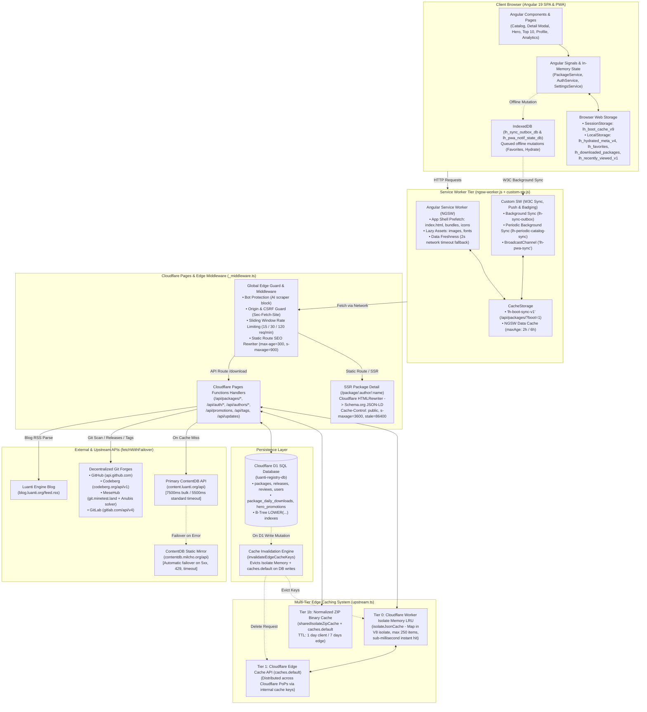

# LuantiHub API & Caching Architecture

This document provides a comprehensive technical overview and architecture reference for all front-end and back-end API calls, caching layers, storage tiers, time-to-live (TTL) configurations, and cache invalidation strategies implemented across **LuantiHub**.

---

## 🏗️ Architecture Overview

LuantiHub employs a **defense-in-depth, multi-tier caching and high-availability architecture** designed to achieve:
1. **Instant Client Bootstrapping:** Zero-latency warm starts using browser `sessionStorage`, `localStorage`, and Angular Service Worker prefetching.
2. **Sub-Millisecond Edge Reads:** High cache-hit rates at Cloudflare's global edge via in-isolate V8 memory caches backed by the Cloudflare Edge Cache API (`caches.default`).
3. **Resilient Upstream Failover:** High-availability proxying to the official Luanti ContentDB API (`content.luanti.org`) with automatic failover to the community mirror (`contentdb.milcho.org`) and Cloudflare D1 distributed SQLite.
4. **Decentralized Git Ingestion:** Direct integration with **Codeberg**, **Mesehub** (`git.minetest.land`), **GitLab**, **GitHub**, and **Bitbucket** with automated `.zip` normalization and multi-day binary caching.
5. **Offline Support & Background Synchronization:** W3C One-Off Background Sync (`sync`) and Periodic Background Sync (`periodicsync`) powered by IndexedDB outbox mutation replay and push notifications.

---

## 🔄 End-to-End System Flowchart



---

## 📦 Tier-by-Tier Technical Breakdown

### 1. Front-End / Client-Side Caching

The front-end client leverages reactive signals, browser storage, and IndexedDB to ensure instantaneous UI rendering and complete offline availability.

| Storage Mechanism | Key / Identifier | Payload & Purpose | Retention / Invalidation Strategy |
| :--- | :--- | :--- | :--- |
| **`sessionStorage`** | `lh_boot_cache_v9` | Bundled boot payload (`/api/packages/?boot=1`): Home tiles, Tags, Top 10 Today & Week, Hero Promotions, Latest Blog Article, Recent Reviews. | Survives page reloads within the same browser tab. Invalidated on hard refresh or when a new deployment bundle hash is detected. |
| **`localStorage`** | `lh_hydrated_meta_v4` | Deep package metadata dictionary keyed by `author/name` (tags, dependencies, minimum Luanti engine version, licenses, repo URLs). | Persists across sessions. Incrementally populated as packages are loaded or hydrated via `/api/packages/hydrate`. Version bumps evict stale data. |
| **`localStorage`** | `lh_favorites` | Array of favorited package IDs (`author/name`). | Automatically reconciled with server-side favorites (`POST /api/auth/favorites`) when the user logs in or reconnects. |
| **`localStorage`** | `lh_active_promotions_v1` | Cached Hero Billboard promotional slides. | Self-prunes whenever an item's `expires_at` timestamp is exceeded. Refreshed on boot sync. |
| **`localStorage`** | `lh_downloaded_packages` | Mapping of `package_id -> download_count` initiated locally. | Merged with server downloads on boot. Used to calculate personalized `% Match` scores. |
| **`localStorage`** | `lh_recently_viewed_v1` | Ring buffer of the last 30 viewed package IDs. | Used for client-side recommendations and personalized match computation. |
| **`localStorage`** | `lh_notification_prefs` | User notification preferences (app updates, package updates, new Git mods, promotions, reviews). | Synchronized to IndexedDB for access by the Service Worker. |
| **`IndexedDB`** | `lh_sync_outbox_db` (`outbox`) | Queue of pending mutations triggered while offline (e.g. `POST /api/auth/favorites`, `POST /api/packages/hydrate`). | Flushed via W3C Background Sync (`sync`) or when network connectivity is restored. |
| **`IndexedDB`** | `lh_pwa_notif_state_db` (`state`) | Notification state shared between UI and Service Worker (`seenTags`, `knownPackageVersions`, `knownGitPackages`, `unreadBadgeCount`). | Synchronized across execution boundaries to prevent duplicate OS notifications. |
| **Angular Signals** | `PackageService` & `AuthService` | In-memory reactive state (`_packages`, `_availableTags`, `_serverTop10Today`, `_promotions`, `_currentUser`). | Runtime memory; automatically recomputed on signal changes. |

---

### 2. Service Worker & PWA Caching

LuantiHub uses a dual-service-worker approach:
- **`ngsw-worker.js` (Angular Service Worker):** Manages asset prefetching and network-first API caching.
- **`custom-sw.js` (LuantiHub PWA Extension):** Implements W3C Background Sync, Periodic Sync, Push Notifications, and Badging.

#### Angular Service Worker Data Groups (`ngsw-config.json`)

```json
{
  "dataGroups": [
    {
      "name": "luantihub-api",
      "urls": ["/api/packages/**", "/api/tags"],
      "cacheConfig": {
        "maxSize": 250,
        "maxAge": "2h",
        "strategy": "freshness",
        "timeout": "2s"
      }
    },
    {
      "name": "packages-api",
      "urls": [
        "https://content.luanti.org/api/packages/**",
        "https://contentdb.milcho.org/api/packages/**"
      ],
      "cacheConfig": {
        "maxSize": 500,
        "maxAge": "6h",
        "strategy": "freshness",
        "timeout": "2s"
      }
    }
  ]
}
```

- **Freshness Strategy:** The service worker attempts a live network fetch for up to **2.0 seconds**. If the network responds within this window, the response is served and cached. If the network times out or fails (e.g., offline or slow mobile connection), the cached copy is served instantly.

#### Custom Service Worker Sync & CacheStorage (`custom-sw.js`)

- **CacheStorage Bucket (`lh-boot-sync-v1`):** Caches `/api/packages/?boot=1`.
- **W3C One-Off Background Sync (`sync`):**
  - `lh-sync-outbox`: Flushes offline mutations from `lh_sync_outbox_db`.
  - `lh-sync-catalog`: Flushes outbox and fetches `/api/packages/?boot=1`.
- **W3C Periodic Background Sync (`periodicsync`):**
  - `lh-periodic-catalog-sync`: Fires in the background (minimum interval ~15 minutes). Fetches boot data, stores it in `lh-boot-sync-v1`, evaluates background package updates/promotions, updates app badges via `self.navigator.setAppBadge()`, and posts updates via `BroadcastChannel('lh-pwa-sync')`.

---

### 3. Cloudflare Edge Middleware (`functions/_middleware.ts`)

Every inbound request to Cloudflare Pages passes through `_middleware.ts` before reaching function handlers:

1. **Bot & Scraper Shield:** Rejects aggressive AI/SEO web scrapers (`GPTBot`, `Bytespider`, `CCBot`, `ClaudeBot`, etc.) with HTTP 403 to protect Cloudflare Function and D1 execution quotas.
2. **CSRF & Origin Guard:** Enforces `Same-Origin` and blocks cross-origin hotlinking for all mutating requests (`POST`, `PUT`, `DELETE`) and internal web endpoints, while allowing legitimate Luanti C++ in-game clients (which send no `Origin`).
3. **Sliding-Window Per-IP Rate Limiting:**
   - **Mutation Endpoints:** 15 requests / minute
   - **Download Endpoints:** 30 requests / minute
   - **Read API Endpoints:** 120 requests / minute
4. **Static Route SEO Prerendering:** Intercepts routes like `/games`, `/mods`, `/texture-packs`, `/git`, `/setup`, `/submit`, `/legal`, and `/blog`. Injects server-rendered meta tags, OpenGraph tags, and Schema.org JSON-LD breadcrumbs with:
   ```http
   Cache-Control: public, max-age=300, s-maxage=900
   ```

---

### 4. Back-End Multi-Tier Edge Caching (`functions/api/lib/upstream.ts`)

Server-side functions execute inside Cloudflare Worker isolates and use a tiered hierarchy:

```
Inbound Request
       │
       ▼
┌──────────────────────────────────────────────┐
│ Tier 0: Isolate Memory LRU (isolateJsonCache) │  ~0.1 ms (Same V8 isolate)
└──────────────────────┬───────────────────────┘
                       │ (Miss)
                       ▼
┌──────────────────────────────────────────────┐
│ Tier 1: Cloudflare Edge Cache (caches.default)│  ~2-10 ms (Cloudflare PoP)
└──────────────────────┬───────────────────────┘
                       │ (Miss)
                       ▼
┌──────────────────────────────────────────────┐
│ Tier 2: Cloudflare D1 Relational SQLite /     │  ~15-40 ms (D1 query)
│ Upstream ContentDB Failover Proxy            │  ~80-350 ms (External fetch)
└──────────────────────────────────────────────┘
```

#### Tier 0: Worker Isolate Memory Cache (`isolateJsonCache`)
- An in-memory JavaScript `Map<string, { exp: number; data: any }>` retained in the active Cloudflare V8 worker instance.
- Capacity: 250 entries with proactive LRU eviction.
- Yields immediate sub-millisecond responses for subsequent hits on the same data center instance.

#### Tier 1: Cloudflare Edge Cache (`caches.default`)
- Distributed edge cache keyed by synthetic internal URLs (e.g. `https://cache.luantihub.internal/...`).
- Shared across worker isolates in the same Cloudflare Point of Presence (PoP).

#### Tier 1b: Normalized ZIP Binary Cache (`sharedIsolateZipCache` + `caches.default`)
- When downloading Git packages, archives are normalized on-the-fly (root folder naming conventions for Luanti engine compatibility).
- The resulting binary buffer is cached in isolate memory and Cloudflare Edge Cache for **7 days** (`s-maxage=604800`):
  ```http
  Cache-Control: public, max-age=86400, s-maxage=604800, stale-while-revalidate=86400
  ```

---

## 📊 Comprehensive API & Caching Matrix

| Endpoint & Method | Upstream / Source | Edge Cache Key | Edge TTL | HTTP `Cache-Control` Header | Invalidation Triggers |
| :--- | :--- | :--- | :--- | :--- | :--- |
| **`GET /api/packages/?boot=1`** | D1 + ContentDB + Hero Promos + Luanti Blog RSS | `/__api_boot_catalog_bundle_v19` | 1,800s (30m) | `public, max-age=300, s-maxage=1800, stale-while-revalidate=3600` | Package published, tag modified, promotion edited, or moderation action taken. |
| **`GET /api/packages/?type=...`** *(In-Game Client)* | Shared from `/__api_boot_catalog_bundle_v19` (`HIT-BOOT-SHARED`) or D1 + ContentDB `/packages/?fmt=vcs` (30m TTL + 24h fallback; skips `/scores/`) | `/__catalog_edge_v10_{query}` | 1,800s (30m) | `public, max-age=120, s-maxage=1800, stale-while-revalidate=3600` | Package mutation in D1. |
| **`GET /api/packages/:author/:name/?lite=1`** | D1 SQL + ContentDB (fast preview payload) | `/__api_pkg_detail_v*/lite/...` | 1,800s (30m) | `public, max-age=300, s-maxage=1800, stale-while-revalidate=600` | Package edit, moderation, or release update. |
| **`GET /api/packages/:author/:name/`** | D1 SQL + ContentDB + Git metadata | `/__api_pkg_detail_v*/full/...` | 600s (10m) | `public, max-age=120, s-maxage=600, stale-while-revalidate=86400` | Package edit, moderation, or release update. |
| **`GET /api/packages/:author/:name/readme`** | Git raw README (GitHub / GitLab / Codeberg / Mesehub) | `/__api_pkg_readme_v4/...` | 86,400s (24h) | `public, max-age=3600, s-maxage=86400, stale-while-revalidate=86400` | Package metadata update. |
| **`GET /api/packages/:author/:name/releases`** | Git smart HTTP refs & forge releases API | `/__git_releases_tags_v3/...` | 120s (2m) | `public, max-age=60, s-maxage=120` *(Bypassed with `?force=1`)* | Time expiration or forced user refresh. |
| **`GET /api/packages/:author/:name/download`** | Upstream ContentDB or Git `.zip` archive | `/__pkg_zip_v3/<author>/<name>/<versionOrLatest>` | 604,800s (7d) | `public, max-age=86400, s-maxage=604800, stale-while-revalidate=86400` | New Git tag, commit SHA, or ContentDB release published (`?reason=update` resolves latest release ID). |
| **`GET /api/packages/:author/:name/dependencies`** | ContentDB `/dependencies/` or Git `mod.conf` | `/__pkg_deps_v2/...` | 600s (10m) | `public, max-age=300, s-maxage=600, stale-while-revalidate=600` | Package dependencies update. |
| **`GET /api/packages/:author/:name/reviews`** | D1 `reviews` table + ContentDB `/reviews/` | Direct D1 + ContentDB Proxy | 0s (Live) | `no-store, no-cache, must-revalidate` | Always real-time. |
| **`POST /api/packages/:author/:name/reviews`** | D1 write mutation | None | N/A | `no-store` | Evicts package detail and boot bundle caches. |
| **`GET /api/packages/top10`** | D1 `package_daily_downloads` + ContentDB scores | Direct D1 Aggregation | 60s (1m) | `public, max-age=60, s-maxage=300, stale-while-revalidate=60` | Re-aggregated per window. |
| **`POST /api/packages/hydrate`** | Batch D1 queries for grid package IDs | `/__api_hydrate_v3_{hash}` | 3,600s (1h) | `public, max-age=300, s-maxage=3600` | Time expiration. |
| **`GET /api/tags`** | ContentDB `/tags/` with static fallback | `/__api_tags_v1` | 3,600s (1h) | `public, max-age=1800, s-maxage=3600` | Hourly upstream refresh. |
| **`GET /api/updates`** | ContentDB `/updates/` + active D1 packages | `/__api_updates_v3_{query}` | 180s (3m) | `public, max-age=120, s-maxage=300, stale-while-revalidate=600` | Evicted on D1 write mutation. |
| **`GET /api/authors/:username`** | D1 users/identities + ContentDB `/users/` | `/__author_profile_v2/...` | 120s (2m) | `public, max-age=60, s-maxage=120, stale-while-revalidate=300` | User profile update or identity link. |
| **`GET /api/promotions`** | D1 `hero_promotions` table | `/__active_promotions_v1` | 21,600s (6h) | `public, max-age=300, s-maxage=1800` | Admin promotion create/update/delete. |
| **`GET /package/:author/:name`** *(SSR)* | Cloudflare `HTMLRewriter` (JSON-LD + meta) | Per-URL Edge Cache | 3,600s (1h) | `public, max-age=300, s-maxage=3600, stale-while-revalidate=86400` | Package metadata update. |
| **`GET /sitemap.xml`** | Static URLs + D1 active packages + ContentDB top 1,500 | Dynamically generated XML | 21,600s (6h) | `public, max-age=3600, s-maxage=21600, stale-while-revalidate=86400` | Recomputed every 6h at Edge. |
| **`GET/POST /api/auth/me` & `/favorites`** | D1 user tables & sessions | None (Security sensitive) | 0s | `private, no-store, no-cache, must-revalidate` | Never cached. |

---

## 🗑️ Cache Invalidation Architecture

When any state-modifying action occurs (e.g., package publication, tag edit, review submission, moderation action, or promotion schedule change), `invalidateEdgeCacheKeys()` executes:

```typescript
export async function invalidateEdgeCacheKeys(cacheKeyPaths: string[]): Promise<void>
```

### Invalidation Mechanics:
1. **Isolate Memory Eviction:** Cleans matching keys and prefix wildcards (`/__catalog_edge_v*`, `/__api_updates_v2_*`, `/__for_client_v2/*`) from the in-memory isolate `Map`.
2. **Edge Cache Purge:** Concurrently issues `edgeCache.delete(req)` against Cloudflare's `caches.default` across all expanded variants (`/full/`, `/lite/`, `/full-readme/`, legacy keys).
3. **Boot Bundle Refresh:** Always clears the global home bundle (`/__api_boot_catalog_bundle_v9`) so home page tiles and swimlanes reflect changes immediately.

---

## 🛡️ Upstream Failover & Rate Limit Resilience

External requests to ContentDB are managed by `fetchWithFailover()` (`functions/api/lib/upstream.ts`):
- **Primary Host:** `https://content.luanti.org/api`
- **Mirror Host:** `https://contentdb.milcho.org/api`
- **Timeout Strategy:** 4,500ms for bulk endpoints (`/scores/`, `?fmt=vcs`, `/packages/`), 4,000ms for standard endpoints, backed by a 24-hour last-known-good Edge Cache fallback (`/__upstream_fallback_packages_vcs_v1`) for `/packages/?fmt=vcs`.
- **Failover Conditions:** Triggered if primary is offline, times out, or returns `5xx` / `429 Too Many Requests`.
- **404 Guard:** Genuine `404 Not Found` responses from the primary are not retried against the mirror, preventing redundant latency.
- **Client Emulation Protection:** Custom `User-Agent: LuantiHub/1.0 (+https://luantihub.org)` avoids triggering ContentDB in-game view counter write operations.
- **Anubis Anti-Bot Protection:** Implements an automated SHA-256 proof-of-work solver for Mesehub (`git.minetest.land`) with a 24-hour edge-cached session cookie (`/__anubis_cookie_v2/*`).

